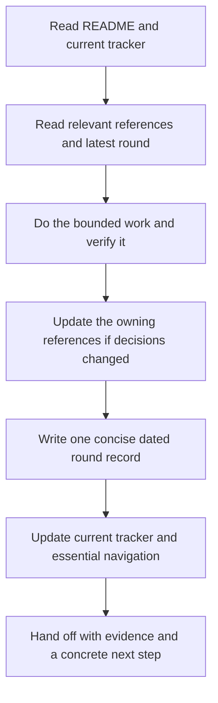

# A lean project documentation workflow

A reusable reference from FMAE, November 20, 2026. Share this document on its own:
it requires no knowledge of FMAE. Adapt the names, folders and level of detail to
your project. This is a working convention, not a requirement to adopt our tooling
or create every document shown below.

The goal is simple: a collaborator should quickly understand **where the project
stands, what rules currently apply, why decisions were made, and what to do next**.
Documentation should make that easier without becoming another project to maintain.

## 1. Give each kind of information one home

| Document | Owns | Avoid putting here |
| --- | --- | --- |
| Root README | Purpose, boundaries, setup entry point, navigation | Detailed progress logs or duplicated specifications |
| One current tracker, often `roadmap.md` | Current milestone, next action, open decisions, blockers, links to latest evidence | Full implementation details or repeated round narratives |
| Authoritative references | Definitions, architecture, interfaces, experiment contracts, operating instructions | A running diary of every change |
| Dated round records | What changed, why, what was checked, what remains uncertain in that round | Copies of entire reference documents |
| Audience-specific entry points, when needed | What a client, operator or external worker needs to know | An obligation to read the entire internal project history |

**One home per fact, links elsewhere.** A README may summarize current work, but
the tracker owns its status. A client guide may summarize an interface, but should
link to its contract. Keep summaries short enough to synchronize easily.

“Authoritative” means authoritative for a stated scope. A versioned experiment
contract still describes that experiment after a newer experiment begins; it does
not silently become the specification for all future models or products.

## 2. Use a small, predictable structure

For example:

```text
README.md
 docs/
   development/
     roadmap.md                 # The single current tracker
     setup.md                   # Running and maintaining the project
     rounds/
       2026-11-20-01-m2b-example.md
   architecture/                # Stable design and interface references
   research/                    # Optional: hypotheses, contracts, results
   clients/
     README.md                  # Optional: external-consumer entry point
```

The folder names are optional. A small project may need only a README, one tracker,
one specification and a rounds folder. Add a document when it has a distinct owner,
audience or subject—not simply because another round happened.

## 3. Work in named increments

Use major milestones and lettered increments when useful, such as `M1`, `M1a`,
`M1b`. Carry the same identifier into round titles and suggested commit messages.
FMAE uses examples such as `F3h` and separate `UR` milestones for substantial user
requests. Other projects should choose their own vocabulary.

An increment describes a coherent outcome, not necessarily one chat or one commit.
A follow-up may retain its increment identifier with a clear title. Dates and an
optional sequence number distinguish multiple records on the same day.

Write **one dated record per substantive round**: a meaningful implementation,
design decision, experiment, review or handoff. Do not create a round for every
question, typo correction, tool call or routine progress check. Related small fixes
can share a record. A long unattended run may need separate launch and review
records because “started successfully” and “results accepted” are different outcomes.

## 4. Keep the update loop short



Before working, recover context from the repository, not only chat memory. Follow
links to relevant references instead of rereading every historical document.

After working, update only documents whose meaning changed. Do not append a new
status section to every reference. Keep the tracker current, link the record, and
leave unrelated documents alone. Commit and push according to the project's
normal authorization policy; documenting work is not itself permission to publish.

## 5. Use compact templates

A current tracker can be this small:

```markdown
# Roadmap and current status
Updated: YYYY-MM-DD. This is the single current-status tracker.

Current: milestone, actual state, and link to evidence.
Next: concrete action and any acceptance condition.
Open decisions or blockers: unresolved choices that affect next work.

Milestones: brief scope and status for each.
Latest round: link. Relevant reference: link.
```

A round record can use the following prompts; omit empty sections:

```markdown
# M2b — Concrete outcome
Date: YYYY-MM-DD. State: proposed / implemented / launched / reviewed / adopted.

Purpose and scope: what this round was meant to resolve.
Changes and decisions: what changed and why; link to the owning references.
Validation: what actually ran, what it found, and where evidence lives.
Limitations: what was not verified or remains uncertain.
Next: the next action, owner or review gate.
```

Use paragraphs or a small table when clearer. A record should be understandable
without the chat, but need not reproduce the code diff. Describe the final work;
include abandoned approaches only when they explain an important decision.

## 6. Separate proposals, evidence and adoption

Keep these distinctions explicit:

- **Proposed:** an idea or plan, not yet agreed or tested.
- **Implemented:** code exists; this alone does not prove it works on real data.
- **Validated:** named checks passed for a stated scope.
- **Adopted:** an explicit decision makes a design or policy the current direction.
- **Deferred or rejected:** retain the reason and any condition for reconsideration.

Report evidence at its actual strength. A synthetic test is not a production test;
a launched job is not a completed experiment; a positive benchmark is not a general
performance guarantee. Negative findings are useful records, not documentation to
hide. For research, distinguish engineering checks from predictive evaluation.

## 7. Preserve history without letting it mislead readers

A dated record saying “not implemented yet” can remain correct as history after
implementation. Update the current tracker and authoritative entry point instead
of rewriting every old record to sound current.

If an older reference could mislead a reader about today's rules, add a brief dated
supersession note linking to its replacement. Correct genuine errors transparently,
with a dated correction where the distinction matters. Preserve frozen contracts,
checksum-pinned evidence and original results; issue a new version or amendment
rather than silently altering their provenance.

Record unresolved questions where they affect current decisions. Do not scatter
competing TODO lists across the repository.

## 8. Make evidence and handoffs usable

Keep source, small manifests and documentation in version control. Large datasets,
model artifacts, logs and credentials need their own storage policy. Reference
reproducible commands, artifact locations and identities where useful; never paste
secrets into records. Avoid heavy provenance machinery for trivial edits.

For long-running work, document how to start, inspect, stop and resume it; where
logs and checkpoints live; and what constitutes completion or acceptance. Capture
important launch/review evidence rather than committing every progress snapshot.

Give each external audience a short entry point. A client should learn what exists,
what is unavailable, how to access it, and its limitations. A compute worker should
receive a bounded assignment, required inputs, deliverables and validation rules.
They should not need to reconstruct the project's entire history.

## 9. Prefer clarity over volume

Use tables for contracts and comparisons. Use a small flowchart when the ordering
of steps, dependencies or failure points is hard to follow in prose. Label proposed,
current and historical paths clearly. Keep diagrams with the reference that owns
the process, and update them when that process changes.

Occasionally check for duplicated instructions, conflicting defaults, stale links,
unlabeled proposals and multiple “current status” documents. Consolidate gently:
retain useful history and repair navigation rather than rewriting everything.

The practical test: **Can the next collaborator find the current state, governing
rules, supporting evidence and next action without asking you to retell the chat?**
If yes, the documentation is doing its job. Add more structure only when it solves
an observed problem.
